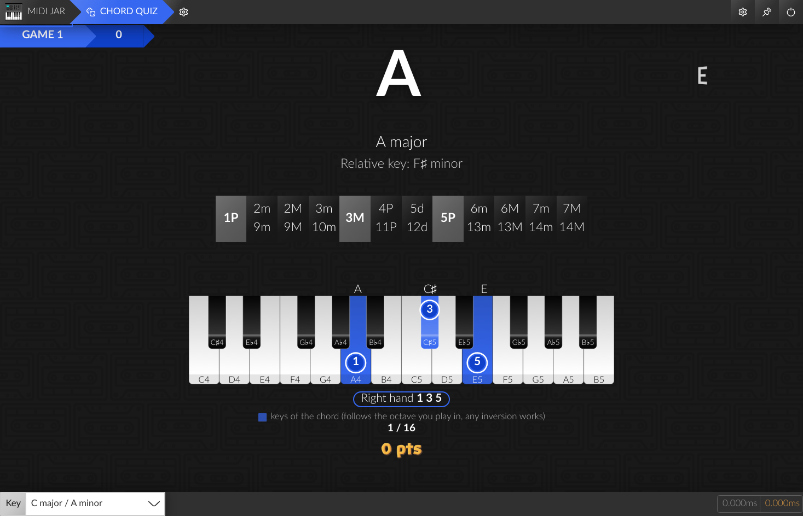
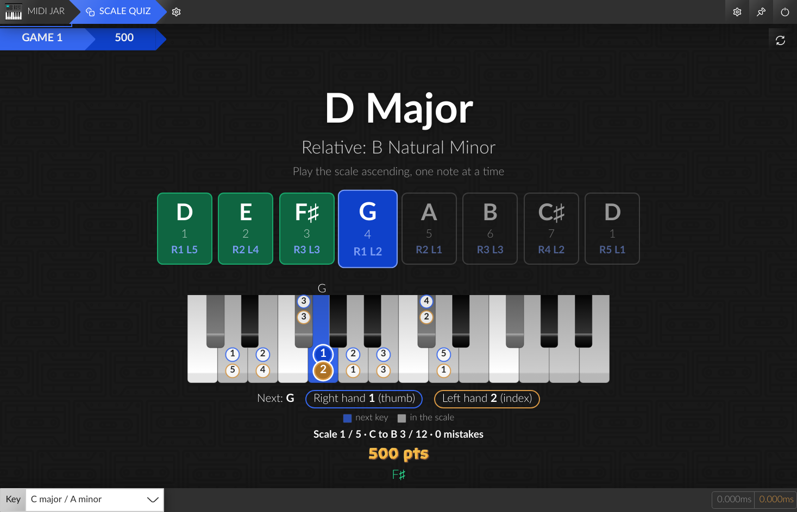

# [MIDI Jar](https://github.com/la-jarre-a-son/midi-jar)

MIDI Jar is a tool box for musicians, learners, streamers, that want to route MIDI message between devices, and display a piano or monitor chords while playing, and integrate it on a video or on a Twitch stream with OBS.


## Releases

Check out the releases on Github: [Releases](https://github.com/la-jarre-a-son/midi-jar/releases)

### Unsigned App

Due to code sign certificates being a bit expensive, MIDI Jar is not signed (yet?).
If you are willing to help me sign this app, financially, don't hesitate to contact me.

So to install it on **Windows**, Windows Defender may block it, and warn you that this could be dangerous. You can still execute it anyway.

On **MacOS** though, the _.dmg_ or any downloaded unsigned file will be blocked, as if "app is damaged and can’t be opened".

You will need to unquarantine the file after you downloaded, by executing in a terminal:

```
xattr -dr com.apple.quarantine <Your Downloaded File Name>
```

## Why this app ?

I needed a way to display a piano and monitor chords when i was playing, but found no solution to do it properly.
So I created a previous tool called [Chord Display](https://github.com/rednetio/chord-display) to do it in a Web browser, but due to Windows having exclusive MIDI (only one software can use the same MIDI device at a time), I needed a new solution.
Plus, OBS BrowserSource is unable to use MIDI devices, so integrating it in a Twitch stream was not possible.

MIDI Jar fixes all theses issues as a Standalone Desktop Application made with Electron.

## Features

MIDI Jar includes:

- MIDI routing between devices and internal modules
- A Chord Display module, to display a piano and monitor chords being played
- A Circle of Fifths highly customizatble
- A Chord Quiz module, with different modes and settings to train
- A Scale Quiz module, to learn scales with a keyboard and fingering
- A Rhythm Game, to play the chords of songs in time (built-in songs, or imported from chord sheets and Ultimate Guitar)
- A Learning Mode for the quizzes and the Rhythm Game, showing the keys to play and the fingering
- A HTTP/Websocket server to include modules externally (in OBS Browser source for instance)
- Running at startup
- Running in background (no window, only Tray icon)

## Routing


You can route MIDI between devices, or to internal and external modules of MIDI Jar, and MIDI messages will be routed when the application is running.

This can be a simple alternative to replace complex softwares like **MIDI-OX** if you _just_ want to route messages from a device to another.

### NOTE FOR WINDOWS USERS:

Windows Standard MIDI drivers are exclusive, only one software can be connected to a device at the same time.

**If you want to use MIDI Jar with other sofwares like your DAW, or a Standalone VST, you should install [loopMIDI](https://www.tobias-erichsen.de/software/loopmidi.html) by Tobias Erichsen.**

You will be able to create multiple Virtual MIDI devices (loopbacks) and route MIDI messages to it. Plus, those virtual devices are non-exclusive, so multiple softwares can use them.

### Latency

MIDI Jar may introduce latency to MIDI messages. I did my best to keep it as low as possible, in the Routing settings page you can see the latency that is introduced by your config: this is only the latency added to the existing latency, from when MIDI Jar receives a message, and forwarded it to other devices and modules.

Any other latency (due to USB, your device drivers or LoopMidi loopback) is not taken into account.

My tests had an `average additional latency < 0.2ms` but this can vary a lot with PC configuration, routing, and CPU Usage, and some freezes could occur.

## Chord Display


Chord Display is a module of MIDI Jar for displaying a piano keyboard and the chords played.

It is based on [tonal](https://github.com/tonaljs/tonal), but with a custom chord dictionary and a modified chord detection feature that allows omissions of intervals (depending on the dictionary).

To use it, route your MIDI devices to the internal `chord-display` output.

### Music Notation

You can enable displaying the standard music notation in Chord Display.

It is implemented with [VexFlow](https://github.com/0xfe/vexflow) and supports displaying notes in any major Key.

NOTE: Key signature that would have more than 7 alterations will be changed automatically to the equivalent major key (e.g. `G#` will produce a key signature of `Ab`).

**DISCLAIMER: As i am not really into reading and writing music, Chord Display notation could be wrong... If so, do not hesitate to post an issue.**

### Customize in Settings

Chord Display rendering is customizable in the Settings:

- Keyboard:
  - Keyboard length: start & end note
  - Wrap: display notes outside of keyboard with a different color
  - Theme:
    - `classic` - a classical looking piano
    - `flat` - a simplified version on a single row
  - Sizes: change skin specific display sizes.
  - Colors: blacks and whites, played & sustained & wrapped notes.
  - Enabling some infos on the piano:
    - `key names` - name displayed on keys (none, only C, pitch class or note)
    - `key info` - additional info display on keys (none, tonic dot, chord intervals)
    - `label`- additional info display above played keys (none, pitch class, note, chord interval)
  - Fade out duration: key disappear with a delay on release
  - Sustained notes: can be disabled on display
- Customizing elements:
  - `chord` - the detected chord
  - `alternative chords` - a list of other detected chord names if any
  - `chord name` - full name of the chord
  - `chord notation` - choose how chords are notated
    - `long` - maj, min, dom, dim, aug
    - `short` - M, m, dim, aug
    - `symbol` - Δ, -, °, +
  - `allow omissions` - detect chords with omitted intervals (like 5P, 9M and 11P)
  - `use sustain` - should sustained notes be used in detection (also disables display of sustained notes)
  - `highlight chord alterations` - display chord parts more distinctly
  - `notation` - the staff notation of the played notes
  - `piano` - a keyboard displaying your played notes
  - `intervals` - a list of intervals that constitutes the chord

### Customize via CSS

OBS Browser Source let you inject any CSS in the page, so you can add any style to existing layout, like:

Disable Background image:
```css
body { background: none !important; color: white; }
```

Remove detected Chord:

```css
#chord {
  display: none;
}
```

Remove Bass Note / Slash chord notation:

```css
.chord-root {
  display: none;
}
```

Remove played Notes:

```css
#notes {
  display: none;
}
```

Remove piano keyboard:

```css
#keyboard {
  display: none;
}
```

Change display order:

```css
#keyboard {
  order: 1;
}
#container {
  order: 2;
}
#notes {
  order: 3;
}
#intervals {
  order: 4;
}
```

Change Text Color:

```css
body {
  color: #fff;
  background: transparent;
}
```

Change chord size and placement:

```css
#chordDisplay {
  align-items: flex-end;
  justify-content: flex-end;
  padding: 2vh;
  flex-direction: column-reverse;
}

#container {
  align-items: flex-start;
  justify-content: space-between;
}

#chord {
  flex-grow: 0;
  font-size: 10vh;
}

#notes {
  display: none;
}

#alternativeChords {
  display: none;
}

#intervals {
  font-size: 2vh;
}

#notation {
  color: black;
  width: 300px;
  height: 300px;
  background: rgba(255, 255, 255, 0.3);
  border-radius: 32px;
  margin-top: 16px;
}
```

## Chord Dictionary


Chord Dictionary is a module of MIDI Jar for browsing the all the chords available in the software, that is a customized diectionary from [tonal](https://github.com/tonaljs/tonal).

You can access it from the home view of MIDI Jar, or by clicking a chord name in a `chord-display` module.

It also allows you to customize how the chords are displayed in all other modules that are using the `preferred` chord notation:
* You can choose what chord alias to be displayed (instead of only the `long`, `short` or `symbol` flavours)
* You can disable a chord type from being detected by the `chord-display` modules.

This module can also be interactive, so you need to route your MIDI devices to the `chord-dictionary` output to let the dictionary work in two possible modes:
* __DETECT__: browse the detected chord page automatically when playing. Notes that are not part the detected chord will be displayed in red, and correct intervals in green.
* __PLAY__: disable automatic browsing, but still display correct and incorrect intervals towards the current displayed chord.

## Circle of Fifths


The Circle of Fifths is a music theory tool to help understanding and writing music.

This modules let you choose easily the Key signature you are playing in, and displaying notes.

It will react (in green), at your choosing:

- `on Chords`: the circle sector that corresponds the most to the currently played chord will be highlighted
- `on Notes`: all sectors that represent the played notes will be highlighted

You can customize its rendering by adding/removing sections of the wheel:

- `Display Major`: displays the circle of major fifths
- `Display Minor`: displays the circle of minor fifths
- `Display Diminished`: displays the circle of diminished fifths
- `Main Scale`: choose which of Major or Minor is displayed first in the circle
- `Display Dominant Chords`: Adds a section containing for each key, the corresponding dominant chords (and substitutions) - V7, bVII7, bII7 and III7
- `Display Suspended Chords`: adds sectors around each minor and major key that are suspended. Their position corresponds to their inversion in the adjacent fifths (e.g.: Csus2 can be inverted as a Gsus4 so it is placed between C and G).
- `Display Alterations`: displays the number of ♭ or ♯ of the coresponding key signature
- `Display Modes`: displays the enharmonic modes above the corresponding keys (e.g. when in C ionian, the next fifth enharmonic mode is G mixolydian)
- `Display Degree`: adds labels for each fifth with its degree and its name
- `Display Degree Label`: adds degree inside the key sectors. Left is major degree, right is minor degree.
- `Highlight Sectors in the key`: shows in blue the sectors in the currently selected key scale

_NOTE: The Circle of Fifths is usually for displaying notes, not chords. But i found that it was also suited for chords, and particularly visualizing resolutions between degrees. Any chord in a same angular part of the circle will tend to resolve to the first degree in the scale. This module is more a personal vision than a standard representation. Don't hesitate to disable the sections you don't need._

## HTTP/WS Server - Overlay

It enables integrating modules in an external web browser, or in an OBS Browser Source. For instance, you can integrate MIDI Jar in your Twitch stream, or load it on a different computer or phone for displaying chords while jamming, and even use it as a Desktop Wallpaper using [Lively Wallpaper](https://rocksdanister.github.io/lively/).

All MIDI Jar module can be accessed externally, and you can create as many `chord-display` modules as you want if, for instance, you want multiple keyboards, or customize their arrangement in OBS.

Currently, updating settings externally is not supported, but this is planned.

## Music Notation

Music Notation can be displayed in the Chord Display module and changed through the Circle of Fifths.

You can customize it in the settings, and this will affect all modules (including the overlay)::

- `Key Signature`: the key signature to display notes in, and for choosing the key in staff notation.
- `Accidentals (when in C Key)`: displays `flats` ♭ or `sharps` ♯
- `Staff Clef`: the Clef to display in staff notation
- `Staff Transpose (in semitones)`: transcribes notes for transposing instruments

## Chord Quiz


You can train piano by using the Chord Quiz module.

Each round of a game you will be prompted a chord that you must play, and will also see the next chord to play (to anticipate your finger movements).

Your answer will be committed when you release all the keys, and can result to different score for the round:

- `different`: You did not play the right chord - you will lose points
- `subset`: You played some intervals of the chord - you will not gain all the points
- `exact`: you played the chord that was asked
- `superset`: you played additional interval that were not asked (and it is considered as a bonus)

Any addition, repetition, or inversions of a chord will grant you additional points.

You can choose which mode (algorithm) to play with:

- `random`: All chords will be picked randomly, in a random key signature
- `random in key`: All chords will be picked from the current key signature (in Notation settings), in the major scale + additions (melodic and harmonic alterations).
- `chord progressions`: Common progressions to learn the numbered (Roman numeral) system, played chord by chord in a random key (natural keys only if you like) or the current key. The progression is shown as numerals with the chord names, the current chord highlighted. Click a progression in the settings to leave it out:
  - Major keys: I–IV–V–I, I–V–vi–IV, I–vi–IV–V, vi–IV–I–V, ii–V–I, ii7–V7–Imaj7
  - Minor keys: i–iv–v–i, i–iv–V–i, i–VI–III–VII, i–VII–VI–V
  - Custom: write your own progressions, one per line (e.g. `I vi ii V`, `ii7 V7 Imaj7`, `i bVI bIII bVII`, `I V/V V I`). Uppercase numerals are major chords, lowercase minor, and you can add `7`, `maj7`, `m7`, `dim`, `ø`, `aug`, `sus4`, `9`..., `b`/`#` for borrowed chords and `V/V` for secondary dominants. A preview shows each one in C

You can also choose which chords are asked:

- `Chords`: Major & minor triads only, Triads (maj, min, dim, aug, sus2, sus4), 7th chords (maj7, m7, 7, m7b5, dim7, mMaj7), 9th chords (maj9, m9, 9, 7b9, 7#9, add9), Triads & 7th chords, or All chords
- `Keys`: all keys, or natural keys only (no sharp or flat root), in `random` mode

In the settings, click a chord of the list to leave it out (or ask it again): for instance `Triads` with only `maj` and natural keys asks the major triads C, D, E, F, G, A and B.

And finally, with `All chords`, to adapt your training, you can choose the difficulty, each levels adds new chords to the possible list:

- `Very Easy`: maj, min
- `Easy`: maj7, majadd2, majadd4, maj6, min7, min6, minadd9, minadd4, minmaj7, dom7, sus4, sus2
- `Medium`: maj9, maj11, maj13, majaddb2, majadd#4, majaddb6, maj6/9, maj6add11, maj6/11, maj7add11, maj7add13, majb5, majb9, min9, min11, min13, minaddb2, min6/9, min7add11, minaddb6, min#5, minb9, minmaj9, minmaj11, minmaj13, minmaj7b9, minmaj7add11, dim, dim7, dom9, dom11, dom13, dom7add6, dom7add11, dom7b9, sus2sus4, sus2maj7, sus4maj7, dom7sus2, dom7sus4, dom9sus4, aug
- `Hard`: maj6#11, maj7add#11, maj7addb13, maj7b5, maj#9, maj#11, maj11b9, minaddb6addb9, min7#5, minb11, min#11, min7#11, min11b13, minmaj7#5, minmaj7addb13, minmaj7b11, minmaj7#11, dimmaj7, dim7maj7, min7b5, dom7b5, dom7add#11, dom7addb13, dom7#9, dom11b9, dom13b9, sus2maj11, sus2maj7add13, sus4maj13, dom7sus4b9, dom13sus4, aug7, augmaj7, augaddb9, augadd9
- `Very Hard`: maj6/9add#11, maj9b5, maj9#9, majb9#9, maj#11b9, maj11#9, maj13#11, min9#5, min11#5, min13#5, min11b11, minmaj9addb13, minmaj11addb13, minmaj9#11, minmaj11b11, min9b5, min7b5b9, min11b5, dom9b5, dom11b5, dom13b5, dom9#11, dom9addb13, dom7b9#9, dom7b9#11, dom7b9b13, dom11b13, dom13#9, dom13#11, dom11susb2, dom7sus4addb13, aug9, aug11, aug13, augmaj9, augadd#9, augmaj7b9, aug7b9, augsus4add7
- `All Chords`: the rest of the dictionary

### Retry until correct

Turn on `Retry until correct` to stay on the same chord after a wrong answer, until you play it right (each miss still loses points).

### Learning Mode

Turn on `Learning Mode` to display a piano keyboard with the keys of the chord to play, and the finger numbers for the right hand, the left hand or both (1 is the thumb, 5 is the pinky). The keyboard follows the octave you play in, and any inversion of the chord is accepted.



If the game mode is too annoying, you can turn off the scoring, the reactions, and choose to display or not the asked intervals and the relative key (A minor for C, C major for Am), but have in mind that the gamification is only for fun, there is no persistent scoreboard or high score, it's only a tool to help exploration.

Hopefully in the future, this module will be able to have an "Intelligent" mode capable of generating random chord progressions with key changes.

[MIDI Jar - Chord Quiz example](https://user-images.githubusercontent.com/1231011/233844786-4f182b44-fcb8-4d24-b69d-532c6286f61e.mp4)


## Rhythm Game

Play along a song: its chords scroll toward a hit line in time with the beat (after a count-in). Play each one as it reaches the line for a Perfect, a Good or a Miss, with combos. The built-in songs are Pachelbel's Canon, House of the Rising Sun, Greensleeves, When the Saints Go Marching In, Amazing Grace and a 12-bar blues, in a random key or the current key.

- `Pattern`: chords follow the song's own rhythm (how long each chord lasts, its time signature like the 3/4 of Amazing Grace, the strumming of Ultimate Guitar songs), or a fixed pattern: once per bar, twice, or on every beat (release the keys between repeated chords)
- `Tempo`: beats per minute, or `Song's Tempo` to play imported songs at their own tempo. With `Speed Up`, the song gets 5% faster every 4 chords in a row, up to 1.5 times the tempo
- `Song Name`: shown from the start, or kept a mystery until the end
- `Learning Mode`: a keyboard with the keys and fingering of the next chord, and what happens on a miss: keep going, wait until the missed chord is played, or slow the song down (it speeds back up after 4 hits in a row)
- `Import Songs`: from ChordPro files (`.cho`, `.chordpro`, `.chopro`, `.pro`, `.crd`, with `[Am]` chords and `{title:}` / `{key:}` / `{tempo:}` / `{time:}`), chord sheets (`.txt`, lines of chords above the lyrics, Ultimate Guitar `[ch]` tags, bar lines like `| C G | Am | % |` for how long chords last), or the web address of a song: a Songsterr song (the chords are found from the notes of its rhythm guitar and bass, with the real tempo, time signature, timing and sections), an Ultimate Guitar chords page with its tempo and strumming, or another chord site. Songs are played in their own key with their numerals, a bar per chord unless bar lines tell otherwise. Importing a song again replaces it. Type a song's tempo in the list if it has none (Ultimate Guitar only gives one with a strumming pattern)
- `Song`: play one song (also picked on the game screen), or random songs among the ones left in
- Big chords (9ths, 11ths, 13ths) are shown in a voicing one hand can play: the 5th, then the 11th are left out, and the notes are packed within an octave. Only those notes are needed for a hit

## Scale Quiz

https://github.com/user-attachments/assets/79e10d36-a1fd-4e74-b41e-3aac776a5d1a

You can learn scales by using the Scale Quiz module.

A scale is asked, and you must play its notes one at a time, in any octave. Each right note scores points, a wrong note loses some, and playing the whole scale without a mistake gives a bonus that grows with your streak of perfect scales.

You can also practice **melodies** instead of scales (`Practice: Melodies`): the notes of a song are shown in order with their degrees, in any key (random, in order, or the current key). The songs are in the public domain: Ode to Joy, Twinkle Twinkle Little Star, Mary Had a Little Lamb, Frère Jacques, Amazing Grace and When the Saints Go Marching In, and you can leave some out.

To **solo over a backing track** (from YouTube for instance), choose `Practice: Solo phrases`, then the key and scale of the track (minor or major pentatonic, blues, major, natural minor, dorian, mixolydian, harmonic minor) and the length of the phrases. Random phrases of that scale are given one after the other, moving mostly by step and ending on the tonic or the fifth; with `Learning Mode`, the keyboard shows every key of the scale and the next note to play.

With `Learning Mode`, melodies and solo phrases also show a recommended finger for each note (in the note boxes, and on the next key of the keyboard), chosen to keep the hand in position, cross the thumb only when needed and avoid the thumb on black keys.

You can choose which scales are asked:

- `Scales`: Major, Natural Minor, both, the Modes (Ionian to Locrian), the Minor scales (natural, harmonic, melodic), Pentatonics & Blues, or all of them
- `Tonic`: `random`, `in order` (going up from C to B through every key), or the tonic of the current key signature (in Notation settings)
- `Keys`: all keys, or natural keys only (no sharp or flat tonic)
- `Direction`: ascending, descending, or up and back down

And how you practice them:

- `Repeat until perfect`: the same scale is asked again until you play it 1, 2 or 3 times in a row without a mistake
- `Jump back`: playing a note you already played in the same direction (like the tonic) continues from that note instead of counting as a mistake
- `Learning Mode`: displays a piano keyboard with the notes of the scale, the next key to play, and the fingering for the right hand, the left hand or both (standard fingerings for major and minor scales, computed for the other scales)



Like the Chord Quiz, the scoring and reactions can be turned off, and you can display the note names, the formula (degrees) of the scale, and its relative scale (A Natural Minor for C Major, C Major for D Dorian).


## What then ?

### Build

This project is built with Electron & Webpack:

```
npm install

npm run start
 -or-
npm run package
```

### Planned features / Ideas

- [x] Simple Routing (v1)
- [x] Chord Display (v1)
- [x] HTTP/WS overlay for OBS (v1)
- [x] Display Standard notation
- [x] Circle of Fifths
- [x] Chords Quiz
- [x] Chord Dictionary
- [ ] Tonnetz chart
- [ ] More Keyboard themes
- [ ] Virtual Keyboard (use pc keyboard as a MIDI device)
- [ ] Visualizations / Vertical scrolling notes
- [ ] Soundboard
- [ ] MIDI recording (playback/backup)
- [ ] Chromesthesia
- [ ] Advanced Routing (split keyboard, filter, velocity/value remapping)
- [ ] Update settings externally (HTTP/WS)

### Contribute / Bugs

This project is fully open to contribution and it would be appreciated to have some feedbacks and new ideas.
Please feel free to open an issue or open a Merge request.

For any UI or UX bug, please [Open an issue](https://github.com/la-jarre-a-son/midi-jar/issues).

If you discover unexpected Chord detection, please see [tonaljs/tonal issues](https://github.com/tonaljs/tonal/issues) and contribute to make it work perfectly.

### Credits

- [tonal](https://github.com/tonaljs/tonal): A functional music theory library for Javascript, that detects chords, and handles MIDI notes
- [VexFlow](https://github.com/0xfe/vexflow): A JavaScript library for rendering music notation and guitar tablature.
- [node-midi](https://github.com/justinlatimer/node-midi) / [@julusian/midi](https://github.com/Julusian/node-midi): A node.js wrapper for the RtMidi C++ library that provides realtime MIDI I/O.
- [React Flow](https://github.com/wbkd/react-flow): Highly customizable library for building interactive node-based UIs, editors, flow charts and diagrams. It allows MIDI Jar to have understandable MIDI routing with nodes and draggable edges.
- [React Electron Boilerplate](https://github.com/electron-react-boilerplate/electron-react-boilerplate): A Foundation for Scalable Cross-Platform Apps in Electron, the base boilerplate for MIDI Jar.
